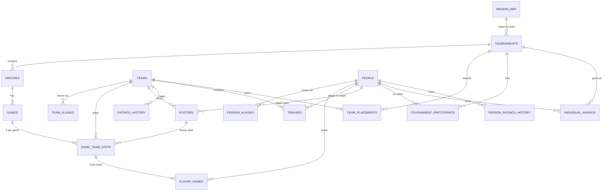

# Global LoL Esports Power Ranking — Design Doc

Oct 13, 2026 · @Ryan

## Goal and scope

Build a weekly global power ranking of tier 1 LoL teams that predicts who wins the next game, with each team's résumé used as a starting point rather than as a score.

| Decision | Choice |
| --- | --- |
| Ranking type | Predictive (Elo-style). Résumé sets starting ratings and uncertainty; results move ratings from there. |
| Unit of rating | Players by role, combined into a team rating, plus team identity and region/role offsets |
| Coverage | Tier 1 leagues and international events. Tier 2 (ERLs, academy leagues) is a later phase. |
| Update cadence | Ratings update after every game internally; a snapshot is published weekly at Monday 00:00 UTC. |
| Benchmarks | Plain Elo baseline, Riot's official Global Power Rankings, closing betting odds |
| Success measure | Lower log-loss and Brier score than all three benchmarks on future games, especially international ones |

Out of scope for v1: tier 2 teams, live in-game prediction, betting recommendations.

## Data sources

Leaguepedia is the main source; Oracle's Elixir fills the stats at 15 minutes that Leaguepedia doesn't store. Leaguepedia table and field names below were checked on its Special:CargoTables page.

| Source | What it gives | Key tables or files | Known gaps |
| --- | --- | --- | --- |
| [Leaguepedia](https://lol.fandom.com/wiki/Special:CargoTables) | Schedule, results, game stats, rosters, people, achievements | `Tournaments`, `MatchSchedule`, `ScoreboardGames`, `ScoreboardTeams`, `ScoreboardPlayers`, `Teams`, `TeamRedirects`, `TeamRenames`, `Players`, `PlayerRedirects`, `PlayerRenames`, `Tenures`, `RosterChanges`, `TournamentRosters`, `TournamentPlayers`, `TournamentResults`, `IndividualAchievements`, `Leagues`, `Regions`, `TeamRegionChanges` | No stats at 15 minutes; names stored as text; 500-row query limit; volunteer edits after the fact |
| [Oracle's Elixir](https://oracleselixir.com) | Stats at 10/15/20/25 minutes per team and player | Yearly CSVs, 12 rows per game | LPL rows may be marked partial (unverified); join to Leaguepedia unverified |
| Riot Global Power Rankings | Benchmark ranking | Weekly snapshot recorded by us | No public history found; check terms before scraping |
| Betting odds | Strongest benchmark | Closing odds from a provider | Historical data usually paid; scraping often forbidden |
| Our own tables | Region by year, tournament weights | `region_map`, `tournaments.weight` | Maintained by hand |

Coach presence per game is not recorded anywhere. It is inferred from `Tenures` date ranges.

## Data model

The core unit is one row per game, with team and player stats in long format and every person (player or coach) in one `people` table.

| Table | Grain | Source | Key fields |
| --- | --- | --- | --- |
| `region_map` | League × year | `Leagues`, `Tournaments`, by hand | league, year, region, league\_level |
| `tournaments` | Tournament | `Tournaments` | tournament\_id, league, year, level, is\_playoffs, weight |
| `matches` | Series | `MatchSchedule` | match\_id, team1\_id, team2\_id, best\_of, is\_fearless, is\_forfeit, winner\_id |
| `games` | Game | `ScoreboardGames` | game\_id, match\_id, riot\_platform\_game\_id, oe\_game\_id, patch, blue/red team, winner, length |
| `game_team_stats` | Team × game | `ScoreboardTeams` + Oracle's Elixir | side, win, roster\_id, continuity, objectives, final\_gold\_diff, gold\_diff\_15 (nullable), data\_completeness |
| `player_games` | Player × game | `ScoreboardPlayers` + Oracle's Elixir | person\_id, role, champion, KDA, CS, damage, vision, \*\_diff\_15 (nullable) |
| `teams` | Team | `Teams` | team\_id, canonical\_name, organization, is\_disbanded |
| `team_aliases` | Name | `TeamRedirects`, `TeamRenames` | alias, team\_id, change\_type (rename or slot sale), effective\_date |
| `rosters` | Lineup | Derived | five starters, head\_coach\_id, first/last game |
| `people` | Person | `Players` | handle, nationality, residency, birthdate, primary\_role |
| `person_aliases` | Name | `PlayerRedirects`, `PlayerRenames` | alias, person\_id, effective\_date |
| `tenures` | Person × team × stint | `Tenures`, `RosterChanges` | role, is\_staff, is\_substitute, date\_join, date\_leave |
| `tournament_participants` | Person × event | `TournamentRosters`, `TournamentPlayers` | tournament\_id, team\_id, person\_id, role |
| `team_placements` | Team × event | `TournamentResults` | place, prize\_usd, is\_achievement |
| `individual_awards` | Award | `IndividualAchievements` | person\_id, tournament\_id, award\_type, place |
| `ratings_history` | Team × week | Model output | rating, rd, region\_offset, global\_rating, global\_rank |
| `person_ratings_history` | Person × week | Model output | rating\_type (player or coach), role, rating, rd |

## Pull pipeline

Data lands raw first, is never edited there, and is normalized into clean tables; every pull is logged so refreshes only fetch what changed.

1. **Setup:** a local SQLite or DuckDB database with `raw_*` and `clean_*` schemas; a Cargo client with 500-row pages, 1–2 s between calls and retry with backoff on `MWException`; a `pull_log(table, scope, pulled_at, row_count)` table.
2. **Reference and identity** (full pull, rarely changes): `Leagues`, `Regions` → `region_map`; `Teams`, `TeamRedirects`, `TeamRenames`, `TeamRegionChanges` → `teams`, `team_aliases`; `Players`, `PlayerRedirects`, `PlayerRenames` → `people`, `person_aliases`; `Tenures`, `RosterChanges`, `Contracts` → `tenures`.
3. **Competition structure** (per year, latest 3–4 years): `Tournaments` for tier 1 leagues plus an allowlist of international events, including showmatches such as the SOOP LoL Invitational → `tournaments`, plus hand-set `level` and `weight`. Don't filter on `IsOfficial` alone: Esports World Cup is tagged `IsOfficial = 0` and DCGI `TournamentLevel = Secondary`. Then `MatchSchedule` for those tournaments → `matches`, dropping `FF` and `IsNullified` rows.
4. **Games** (per tournament, or per month for large leagues): `ScoreboardGames` → `games`; `ScoreboardTeams` → `game_team_stats`, side from `Side`; `ScoreboardPlayers` → `player_games`, `Link` mapped to `person_id`.
5. **Achievements:** `TournamentResults` → `team_placements`; `TournamentRosters` / `TournamentPlayers` → `tournament_participants`; `IndividualAchievements` → `individual_awards`.
6. **Oracle's Elixir:** download yearly CSVs by hand into their own folder; join on `gameid` ↔ `RiotPlatformGameId`, falling back to date + teams + game number; fill `*_15` fields and `data_completeness`, leaving partial rows null.
7. **Derived:** `rosters` from lineups, `head_coach_id` from `tenures` by game date, `continuity` per team-game.
8. **Validation** (after every pull):
   - Coverage: scoreboard games vs. games implied by `MatchSchedule` scores; flag leagues under 95%.
   - Integrity: 2 team rows and 10 player rows per game; one winner; series scores match game wins.
   - Identity: list every unmapped team or player name and fix the alias tables by hand.
   - Join rate: share of games matched to Oracle's Elixir, by league.
9. **Weekly refresh:** re-pull the last 4 weeks of steps 3–6, then rerun steps 7–8.

## Model design

A team's predicted strength is its five starters' ratings, adjusted for team identity and region, and updated after every game.

&#91;embedded content: model flow · player ratings to team strength to prediction\]

Résumé sets where players start; team identity and region offsets adjust the combined lineup; each result feeds back into player ratings.

### Components

| Component | What it captures | Inputs | Notes |
| --- | --- | --- | --- |
| Player rating (by role) | Individual strength | `player_games`, opponent ratings | Elo-style, opponent-adjusted; stats compared only within role and season |
| Résumé prior | Starting rating and uncertainty for each player | MVPs, All-Pro selections, Worlds appearances, titles, international appearances | Counted as of the game date; weight fades as games accumulate |
| Team rating | Strength of the current lineup | Five starters' ratings | Roster changes are handled automatically |
| Team identity | Structure and drafting a staff brings | Draft and structure features over the coach's tenure | Belongs to team + staff era; fades if the coach leaves |
| Region and role offsets | Strength of each region, per role | International games, player and coach moves between regions, Demacia Cup Global Invitational | Pulled toward the average with a shared prior; carried across years with decay |
| Update size | How much one game moves ratings | Event weight, playoffs, fearless game number, margin of victory | Weights tuned in backtest, not hand-fixed |

### Cross-region events beyond MSI and Worlds

The [Demacia Cup Global Invitational (DCGI)](https://lol.fandom.com/wiki/2026_Demacia_Cup_Global_Invitational) gives cross-region games between mid-table teams, the depth that MSI and Worlds never show.

| Fact | 2026 edition |
| --- | --- |
| Dates and location | 3–17 October 2026, China |
| Organizer | Huya, TJ Sports (not Riot) |
| Teams | 12 that missed Worlds: LCK and LPL 5th–7th seeds, LEC and LCS 4th–5th, LCP and CBLOL 4th |
| Format | Swiss stage (round 1 Bo1, later rounds Bo3), then single-elimination Bo5 |
| Patch | 26.18 |
| Rule difference | Coach comms allowed, which matters for team-identity and coach features |
| Leaguepedia tags | Region International, TournamentLevel Secondary, IsOfficial 1; scoreboards available |
| Earlier edition | 2025, listed by Leaguepedia in the same series; check its participants before using it |

Use: include DCGI in region-offset fitting with its own weight, below MSI and Worlds, and let it inform offsets for teams ranked below the top seeds. Flag the coach-comms rule when building team-identity features from these games.

The [SOOP LoL Invitational](https://lol.fandom.com/wiki/2026_Cross_Regional:_SOOP_LoL_Invitational) is a smaller link between Korea and the Americas, held during the MSI bootcamp in Korea.

| Fact | 2026 edition |
| --- | --- |
| Dates and location | 26–27 June 2026, South Korea |
| Organizer | SOOP Esports (not Riot) |
| Teams | LCK: DN SOOPers, Dplus KIA, Kiwoom DRX. Americas: FlyQuest, Cloud9, LØS |
| Format | 9 Bo1 games, Korea vs. Americas; Korea won 5–4 |
| Patch | 26.13 |
| Leaguepedia tags | Region International, TournamentLevel Showmatch, IsOfficial 0 |
| Data available | Results in `MatchSchedule` only; no scoreboards, so no game stats |

Use: win/loss updates only, at a low weight. It is a showmatch during a bootcamp, so effort may be closer to scrims than to official play.

### Team identity features

- **Draft:** champion pool depth, share of picks strong on the patch, first-pick vs. counter-pick results, unique champions played.
- **Structure:** early objective share (grubs, first dragon, herald), gold diff at 15 vs. final result, lead-loss rate, consistency game to game.
- **Fearless:** game number in series, champions already used, share of usual pool still available.

### Feature compression

Many player stats are correlated (gold, damage, CS and kills mostly measure the same thing), so a few combined columns can replace dozens of raw ones.

| Method | What it does | When to use |
| --- | --- | --- |
| PCA | Builds uncorrelated combinations that keep the most variance | First choice; fast and simple |
| Factor analysis | Finds a few hidden factors (e.g. laning, teamfighting) behind the stats | When named, readable factors matter |
| Ridge / lasso regression | Keeps all stats but shrinks or drops weak ones | When the goal is prediction, not new columns |
| Autoencoder | Neural network compression | Not worth it at this data size |

Rules: fit per role, only on the training window, on season-standardized stats. Keep compression only if it beats raw stats with ridge in the backtest.

## Point-in-time correctness

Every input to a prediction must be knowable the morning of that game. Results and stats are used to update ratings after a game, never as inputs to predict that same game.

### Guardrails

1. **Two kinds of tables.** Game tables (`games`, `game_team_stats`, `player_games`) record what happened. The model reads only from a separate `pregame_features` table, keyed by (game\_id, team\_id), built from earlier games. Raw columns like `gold_diff_15` never go into the model directly.
2. **Lagged aggregates only.** In-game stats reach the model as rolling averages over previous games, e.g. a team's average gold diff at 15 over its last 10 games, computed with `datetime_utc < this game's datetime_utc`. In pandas, that means `shift(1)` before any `rolling()`.
3. **One as-of function.** Every feature is built by one function `features(entity, as_of)` that filters all source rows to `as_of`. No feature code queries tables directly.
4. **Source-date stamp.** Each feature row stores `max_source_date`, the latest date of any row it used. An automated test fails if any `max_source_date >= game datetime`.
5. **Future-tamper test.** Change or delete every game after a cutoff date and rebuild features; features for games before the cutoff must not change.
6. **Fit transforms in the past.** Normalization, PCA and region offsets are fitted only on the training window and reused unchanged on test games.
7. **As-of résumé.** Achievements, tenures and roster changes are counted only if dated before the game. For roster dates Leaguepedia corrected later, use the date the change was announced, or a short buffer.
8. **Snapshots of the source.** Keep each raw pull, so a backtest can be rebuilt from data as it looked at the time.
9. **Too-good check.** Measure the plain Elo baseline's accuracy first. If a new feature suddenly lifts accuracy far above it, assume a leak until proven otherwise; real gains in game prediction are small.

## Evaluation and benchmarks

The model wins if it predicts future games better than all three benchmarks, measured by log-loss and Brier score in a time-ordered backtest.

### Backtest

- Rolling origin: train on years up to N, test on year N+1, then move forward one year. Never shuffle games.
- Report results overall, for international games only, and for teams after a roster change.
- Tune hyperparameters (K-factor, event weights, résumé prior strength, decay) on earlier years only.
- International games are few (about 100–200 a year), so judge international accuracy over several years.

### Benchmarks

| Benchmark | How to compare | Notes |
| --- | --- | --- |
| Plain Elo (win/loss only) | Same games, same metrics | Every feature must beat this to stay |
| Riot Global Power Rankings | Convert their scores to win probabilities with a logistic fit on past games; compare log-loss and Brier; also Spearman rank correlation | Elo-based, 55% team + 45% league, team window 2 years, league window 3 years ([Riot dev diary](https://lolesports.com/news/dev-diary-unveiling-the-global-power-rankings)). Expect high correlation; the edge should show after roster changes. Never tune toward it. |
| Closing betting odds | Remove the bookmaker margin, convert to probabilities, compare on the same games | Toughest benchmark; record source and timestamp |

### Disagreement review

Each week, list the 5–10 teams where our rank differs most from Riot's and from the odds, then record who was right once results are in.

## Publishing and operations

A ranking is published every Monday at 00:00 UTC from ratings updated game by game during the week.

- **Cutoff alignment:** Riot's rankings and closing odds are recorded at the same cutoff, so all comparisons cover the same games.
- **Published rank vs. raw rating:** raw ratings drive predictions; an optional smoothed rank is published to avoid large week-to-week swings. The smoothing is a separate, documented step.
- **Explanations:** every move carries a reason, e.g. "+40: beat GEN 3–1 as underdog" or "−25: new mid laner, rating uncertainty raised".
- **Uncertainty:** teams with few games or a new roster are labelled uncertain instead of being hidden.
- **Versioning:** each published ranking stores the data snapshot ID, code version and hyperparameters.
- **Licensing:** Leaguepedia data is CC BY-SA (share-alike may apply to redistributed data); Oracle's Elixir requires attribution; check terms for Riot's site and any odds source.

## Risks and open questions

The biggest risks are leakage, thin cross-region data and identity mismatches; each has a mitigation above.

| Risk | Impact | Mitigation |
| --- | --- | --- |
| Leakage from future data | Backtest looks better than live results | Point-in-time guardrails and automated tests |
| Few cross-region games | Noisy region offsets, especially minor regions | Shared prior, decay across years, player moves as links, extra cross-region events |
| Offsets learned from top seeds only | Lower-ranked teams in a region mis-rated | Offset may vary by within-region rank; DCGI covers LCK/LPL 5th–7th and LEC/LCS 4th–5th seeds; higher uncertainty for lower teams |
| Offsets stale between events | Mid-year regional improvement missed | Player moves between regions; DCGI results each October |
| Bad name-to-ID joins | Confident but false player ratings | Alias tables and unmapped-name report every pull |
| Player stats reflect team and role | Carries on weak teams undervalued | Within-role, opponent-adjusted ratings |
| Season objective changes (grubs, Atakhan) | Features drift across seasons | Season-standardized features |
| Coach effects hard to isolate | Overfitting to staff noise | Measure team identity per coach tenure, shrink strongly |
| Too many parameters for the data | Overfitting | Add one component at a time, keep only backtest wins |

### Open questions

- [ ] How much weight should DCGI get, given it is not run by Riot and teams may treat it as lower stakes?
- [ ] Does Oracle's Elixir `gameid` match Leaguepedia `RiotPlatformGameId`?
- [ ] How complete is Oracle's Elixir LPL data at 15 minutes?
- [ ] Is there a public archive of Riot's past power rankings?
- [ ] Which odds provider, and at what cost?
- [ ] Publish a smoothed rank, or raw ratings only?

Future state, national teams sharing player ratings with clubs: Future: national teams
