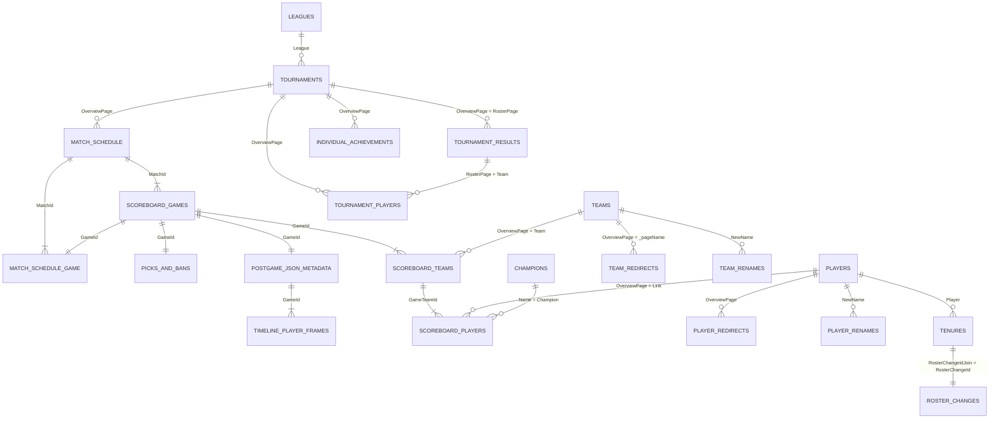

# Leaguepedia data spec

What to pull from Leaguepedia, which columns, how the tables join, and what was verified. Checked against live Leaguepedia data on 2026-10-21.

Files that go with this spec:
- `raw_schema.sql`: raw tables, columns named exactly as in Leaguepedia
- `schema.sql`: clean model tables
- `erd_generated.md`: ERD of the clean model, generated from DuckDB

## 1. Verification results

Every core table was checked on real tournaments. "Expected games" is the sum of series scores in `MatchSchedule`.

| Tournament | Series | Expected games | Scoreboard games | Duplicate GameId | Games missing a series | Player rows | Empty `Link` | Draft rows | Timelines |
|---|---|---|---|---|---|---|---|---|---|
| LCK 2026 Rounds 1-2 | 90 | 204 | 204 | 0 | 0 | 2,040 | 0 | 204 | 204 |
| LPL 2026 Split 2 | 71 | 171 | 171 | 0 | 0 | 1,710 | 0 | 171 | **0** |
| LEC 2026 Summer | 45 | 106 | 106 | 0 | 0 | 1,060 | 0 | 106 | 106 |
| LCS 2026 Summer | 28 | 64 | 64 | 0 | 0 | 640 | 0 | 64 | 64 |
| LCP 2026 Split 2 | 28 | 69 | 69 | 0 | 0 | 690 | 0 | 69 | 69 |
| MSI 2026 | 20 | 71 | 71 | 0 | 0 | 710 | 0 | 71 | 71 |
| Worlds 2025 Main Event | 40 | 80 | 80 | 0 | 0 | 800 | 0 | 80 | 80 |
| Demacia Cup Global Invitational 2026 | 27 | 71 | 71 | 0 | 0 | 710 | 0 | 71 | **39** |

Also verified:
- **Team names:** all 47 team names in 2026 scoreboards match a `Teams.OverviewPage` exactly.
- **Player links:** `ScoreboardPlayers.Link` matched `Players.OverviewPage` for 187 of 188 players, after ignoring the case of the first letter (see gotcha 3).
- **Older seasons:** LCK 2023 Summer has timelines for all 206 games.
- **Key formats:**
  - `MatchId`: `LCK/2026 Season/Rounds 1-2_Week 1_1`
  - `GameId`: `..._Week 1_1_1`
  - `GameTeamId`: `..._Team1`
  - `GameRoleId`: `..._1_1`

## 2. Tables to pull

### Core game data

| Leaguepedia table | Raw table | Primary key | Keep | Drop | Notes |
|---|---|---|---|---|---|
| `Leagues` | `raw.leagues` | League | League, League_Short, Region, Level, IsOfficial | | `Region` is today's region; `Tournaments.Region` gives the region per year. `IsOfficial` is text 'Yes'/'No'. |
| `Tournaments` | `raw.tournaments` | OverviewPage | OverviewPage, Name, StandardName, League, Region, Year, Split, SplitNumber, DateStart, Date, TournamentLevel, IsQualifier, IsPlayoffs, IsOfficial, EventType, Organizer, Country, BasePage, AlternativeNames | Prizepool, Currency, Rulebook, Links, Sponsors, Tags, ScrapeLink | `Year` is text. Select tournaments with a league + event allowlist; never filter on `IsOfficial` alone (EWC = 0, SOOP = Showmatch). |
| `MatchSchedule` | `raw.match_schedule` | MatchId | MatchId, OverviewPage, Team1, Team2, Winner, Team1Score, Team2Score, FF, IsNullified, IsTiebreaker, BestOf, DateTime_UTC, HasTime, Tab, Round, Phase, GroupName, MatchDay, Patch, DisabledChampions | UniqueMatch, streams, casters, VODs, predictions fields, footnotes | `Winner` is text '1'/'2'. Stage is often only in `Tab`: `Round` and `Phase` were empty for DCGI. |
| `MatchScheduleGame` | `raw.match_schedule_game` | GameId | GameId, MatchId, OverviewPage, N_GameInMatch, Blue, Red, Winner, IsRemake, IsChronobreak, FF, Selection, PickSelection, FirstPick, FirstSelection, HasSelection, MVP, RiotPlatformGameId | VOD and recap fields | **New.** Explicit Blue/Red per game, side and pick selection (draft features), remakes to filter out. |
| `ScoreboardGames` | `raw.scoreboard_games` | GameId | GameId, MatchId, OverviewPage, Tournament, N_GameInMatch, DateTime_UTC, Team1, Team2, WinTeam, LossTeam, Winner, Gamelength_Number, Patch, PatchSort, RiotPlatformGameId | All Team1*/Team2* stat columns (duplicates of ScoreboardTeams), UniqueLine, Gamelength (text), VOD, MatchHistory | `RiotPlatformGameId` is empty for LPL. |
| `ScoreboardTeams` | `raw.scoreboard_teams` | GameTeamId | GameTeamId, GameId, MatchId, OverviewPage, Team, Side, Number, IsWinner, Bans, Picks, Roster, Dragons, Clouds, Infernals, Mountains, Oceans, Hextechs, Chemtechs, Elders, Barons, Towers, Gold, Kills, RiftHeralds, VoidGrubs, Atakhans, Inhibitors | UniqueGame, UniqueTeam, StatsPage, Score | `UniqueGame` is shared by both team rows; not a key. |
| `ScoreboardPlayers` | `raw.scoreboard_players` | GameRoleId | GameRoleId, GameId, GameTeamId, MatchId, OverviewPage, Link, Name, Team, TeamVs, Role, Role_Number, Side, Champion, Kills, Deaths, Assists, Gold, CS, DamageToChampions, VisionScore, TeamKills, TeamGold, PlayerWin, DateTime_UTC | Items, SummonerSpells, Trinket, RoleBoundItem, Runes, KeystoneRune, KeystoneMastery, PrimaryTree, SecondaryTree, Pentakills, Time, DST, IngameRole, UniqueLine*, UniqueRole*, StatsPage | `Side` is 1/2 here, but 'Blue'/'Red' in ScoreboardTeams. Dropped columns are low value for v1. |
| `PicksAndBansS7` | `raw.picks_and_bans` | GameId | GameId, MatchId, OverviewPage, N_GameInMatch, Team1, Team2, Winner, SwitchedSides, Team1/2 Ban1-5, Team1/2 Pick1-5, Team1/2 Role1-5, Team1/2PicksByRoleOrder, IsComplete | UniqueLine, N_* page counters, GameID_Wiki | **New.** The only source of draft **order** and pick roles. |
| `PostgameJsonMetadata` | `raw.postgame_json_metadata` | GameId | GameId, RiotPlatformGameId, StatsPage, TimelinePage | Riot hash and version fields | **New.** `TimelinePage` holds Riot's per-minute data. |
| Timeline pages (`V5 data:<id>/Timeline`) | `raw.timeline_player_frames` | GameId, ParticipantId, Minute | totalGold, xp, minionsKilled, jungleMinionsKilled, level at minutes 10 and 15 | Everything else in the JSON | **New source of stats at 15 minutes.** About 0.9 MB of JSON per game: extract minutes 10 and 15, then discard. |

### Identity

| Leaguepedia table | Raw table | Primary key | Keep | Drop | Notes |
|---|---|---|---|---|---|
| `Teams` | `raw.teams` | OverviewPage | OverviewPage, Name, Short, Region, Location, OrganizationPage, IsDisbanded, RenamedTo | Social links, Image, RosterPhoto, TeamLocation | |
| `TeamRedirects` | `raw.team_redirects` | AllName | AllName, **_pageName** | OtherName, UniqueLine | The target team is the Cargo field `_pageName`. `OtherName` was empty in every row checked. |
| `TeamRenames` | `raw.team_renames` | (none) | Date, OriginalName, NewName, Verb, Slot, IsSamePage, NewsId | | Required: `SK Telecom T1 → T1` is a "rebrand" with `IsSamePage = No`, i.e. two separate team pages. Redirects alone do not merge them. |
| `Players` | `raw.players` | OverviewPage | OverviewPage, ID, Player, Name, NativeName, Country, NationalityPrimary, Nationality, Birthdate, Residency, ResidencyFormer, Role, IsRetired, IsSubstitute, IsTrainee, IsPersonality | **Team, Team2, CurrentTeams, TeamLast, RoleLast, Contract, ContractText, Age**, social links | Dropped columns are today's values; using them for past games leaks the future. History comes from Tenures. `ID` is not unique: two players have ID "Cube". |
| `PlayerRedirects` | `raw.player_redirects` | AllName | AllName, OverviewPage, ID | | Maps any name to the canonical player page. |
| `PlayerRenames` | `raw.player_renames` | (none) | Date, OriginalName, NewName, IsRestyle, NewsId | | |

### Rosters, coaches, achievements

| Leaguepedia table | Raw table | Primary key | Keep | Drop | Notes |
|---|---|---|---|---|---|
| `Tenures` | `raw.tenures` | (none) | Player, Team, DateJoin, DateLeave, ContractEnd, RosterChangeIdJoin, RosterChangeIdLeave, NextTeam, NextIsRetired, IsCurrent | Duration, ResidencyLeave, NameLeave, NextIsWildrift, NextIsDeceased | Includes staff. **No role column**: get the role through `RosterChangeIdJoin`. `Team` is the name at the time. |
| `RosterChanges` | `raw.roster_changes` | (none) | RosterChangeId, Date_Sort, Player, Direction, Team, RolesIngame, **RolesStaff**, Role, Status, Tournaments, NewsId | Source, Preload, PreloadSortNumber, CurrentTeamPriority, RoleDisplay, RoleModifier, Tags, N_LineInNews | `RolesStaff` values include Coach, Head Coach, Interim Head Coach. List fields need `HOLDS` / `HOLDS LIKE` in Cargo filters. |
| `TournamentPlayers` | `raw.tournament_players` | (none) | OverviewPage, Team, Link, Player, Role, N_PlayerInTeam | Flag, Footnote, TeamOrder, PageAndTeam, IsDistribution | Includes coaches (`Role = 'Coach'`). Its `OverviewPage` is the stage page. |
| `TournamentResults` | `raw.tournament_results` | (none) | OverviewPage, RosterPage, Event, Tier, Date, Team, Place, Place_Number, Phase, Qualified, Prize_USD, IsAchievement, Showmatch | Prize (local), Prize_Euro, PrizeUnit, Prize_Markup, LastOpponent_Markup, UniqueLine | **New.** `OverviewPage` is the event ("2025 Season World Championship"); `RosterPage` is the stage and joins to `TournamentPlayers.OverviewPage`. `Date` = when the placement was decided, used for as-of résumé counts. |
| `IndividualAchievements` | `raw.individual_achievements` | (none) | Player, Link, Team, OverviewPage, Display, Place, Place_Number, AchievementType | Description | Only 2,591 rows. `Link` is empty in 2,582: map `Player` through PlayerRedirects. `Display` spellings vary ("All Pro Team", "1st All Pro Team", "2nd All-Pro Team", "2nd All Pro-Team"): normalize. |
| `Champions` | `raw.champions` | Name | Name, Attributes, Resource, ReleaseDate | Stats, prices, titles | Optional; class tags for draft features. |

### Not pulled (and why)

| Table | Reason |
|---|---|
| `TournamentRosters` | Same data as TournamentPlayers, packed into one text field |
| `Standings` | Can be derived from matches; useful only as a validation check |
| `Teamnames` | Name-to-team lookup used by the wiki; scoreboard names already match `Teams` |
| `TenuresUnbroken` | Alternative to Tenures; revisit if renames split tenures |
| `Contracts`, `ResidencyChanges`, `Retirements`, `TeamRegionChanges` | Undated or low value for v1 (dates live in `NewsItems`) |
| `NewsItems` | Large; only needed for exact announcement dates |
| `PatchNotes` | Empty (0 rows) |
| `Organizations`, `SisterTeams` | Tier 2 / org analysis later |
| Social, media, VOD, prediction, broadcast tables | Not relevant |

## 3. How the tables join

Team and player names in every table are text, as written at the time. Before joining, resolve each one to a canonical page:

1. Fix the first letter (gotcha 3).
2. Look it up in `PlayerRedirects` / `TeamRedirects`.
3. Follow `TeamRenames` / `PlayerRenames` forward to the latest name.

## 4. Gotchas found during verification

1. **API field names use spaces.** The Cargo API returns `N_GameInMatch` as `N GameInMatch` and `DateTime_UTC` as `DateTime UTC`. Rename spaces to underscores on load, or alias every field in the query.
2. **Team1 means different things.** In `MatchSchedule`, Team1 is the series' first-listed team. In the scoreboard tables it is the blue side of that game, so it changes from game to game. Never join on position; use `MatchScheduleGame.Blue` / `Red` or `ScoreboardTeams.Side`.
3. **First-letter case.** Wiki page names always start with a capital, but stored links sometimes don't (`climber` vs. page `Climber`). Uppercase the first character before matching names to pages.
4. **List fields.** Picks, bans, players and nationality use `,`; items and roles use `;`. Filtering them in Cargo needs `HOLDS` / `HOLDS LIKE`, not `=` or `LIKE`.
5. **Text booleans.** `Leagues.IsOfficial` and `PlayerWin` are 'Yes'/'No'; `MatchSchedule.Winner` is '1'/'2' as text; `Tournaments.Year` is text.
6. **LPL has no timeline data:** zero timelines and no `RiotPlatformGameId` in LPL 2026 Split 2. LPL games will have no 15-minute stats unless Oracle's Elixir has them.
7. **Chinese-hosted events are partial:** DCGI has timelines for 39 of 71 games.
8. **Timeline size:** about 0.9 MB per game, so 10,000 games is about 9 GB to download. Throttle, extract minutes 10 and 15, and keep only the extracted rows.
9. **Current-value columns:** Players' current team, role, contract and residency describe today, not the past. Drop them, or use them for display only.
10. **Event vs. stage pages:** `TournamentResults.OverviewPage` is the event page; `RosterPage` is the stage page that the rosters and games use.

## 5. Your original list: what changed

| Your table | Main changes |
|---|---|
| Region Map | Built from `Leagues` + `Tournaments` (region per year comes from Tournaments). PK = League + Year, with Year as an integer. |
| Tournament | Kept. Added the allowlist rule; fixed example rows (real OverviewPage format: `LCK/2026 Season/Rounds 1-2`). |
| People | PK changed from `ID` to `OverviewPage`. Added Residency, IsSubstitute, IsPersonality. Dropped current-team and contract fields. |
| Teams | Added Region, OrganizationPage, RenamedTo. PK = OverviewPage. |
| Matches | PK = `MatchId`. Added IsTiebreaker, Round, Phase, GroupName. Kept Tab (the stage label). |
| Games | PK = `GameId`. Added MatchId, N_GameInMatch, PatchSort, RiotPlatformGameId. Removed 40 duplicated Team1/Team2 stat columns. Fixed typo `Team12nfernals`. |
| Game_team_stats | PK = `GameTeamId` (not `UniqueGame`). Added GameId, MatchId, OverviewPage. |
| Player_games | PK = `GameRoleId`. Added GameId, GameTeamId, MatchId, OverviewPage. Dropped items, runes, spells. |
| Teams Alias / Team Redirects | Added `_pageName` (the real target). |
| PlayerRedirects / PlayerRenames | Unchanged. |
| Tenures | Unchanged; role comes from RosterChanges. |
| RosterChanges | Added `RolesStaff` (coaches). Dropped Source, Preload fields. |
| TournamentRosters | Not pulled; TournamentPlayers covers it. |
| TournamentPlayers | Unchanged. |
| Individual_awards | Unchanged columns; added notes on empty `Link` and inconsistent `Display`. |
| Rating tables | Not pulled (model output); fixed the mislabeled table and added keys. |
| **New** | MatchScheduleGame, PicksAndBansS7, PostgameJsonMetadata + timelines, TournamentResults, Leagues, Champions (optional). |

## 6. Not yet verified

These need a check during the first test pull; none blocks starting.

- [ ] `PicksAndBansS7.Team1` is blue unless `SwitchedSides` is set. Confirm on a few games against `MatchScheduleGame.Blue`.
- [ ] Uniqueness of `RosterChangeId` and of (Player, Team, DateJoin) in Tenures. No PK is set on these raw tables until checked.
- [ ] Coverage before 2023 for timelines, `MatchScheduleGame` selection fields and `PicksAndBansS7`.
- [ ] CBLOL 2026 pages (`CBLOL/2026 Season/...`) were listed but not checked game by game.
- [ ] `IndividualAchievements` completeness: 2,591 rows across all leagues and years is likely incomplete for older seasons.
- [ ] Whether any 2026 tier 1 player is missing a `Players` page (1 of 188 checked did not match).

## 7. Recommended first pull

Pull one full tournament (e.g. `LCK/2026 Season/Rounds 1-2`) into the raw tables. Run the section 1 checks plus the open items above, then scale to all tier 1 leagues for 2023-2026.
